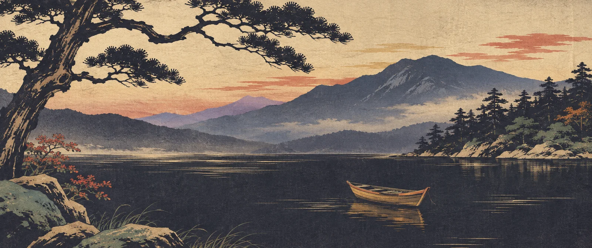

# Oma Easel

Generates new background images for an installed [Omarchy](https://omarchy.org) theme, in the style of its existing backgrounds and colors, sized for your screens.

New backgrounds go into `~/.config/omarchy/backgrounds/<theme>/`, where Omarchy picks them up for that theme's background cycle. Themes themselves are never modified.

> Early days.

## Example

Omarchy's built-in [Kanagawa theme](https://github.com/omacom/omarchy/tree/quattro/themes/kanagawa) ships Hokusai's Great Wave as [its background](https://github.com/omacom/omarchy/blob/quattro/themes/kanagawa/backgrounds/1-kanagawa.jpg). With that as the only style reference and the scene *"a quiet mountain lake at dusk with a lone wooden boat and pine trees"*, Oma Easel (through Codex) made a new background in the same woodblock-print style and the theme's colors, sized for a 3440x1440 ultrawide:



Kept, it lands in `~/.config/omarchy/backgrounds/kanagawa/` and joins Kanagawa's background cycle; the theme itself is untouched.

## How it works

1. Load a theme: its `colors.toml` and every background it has.
2. Pick existing backgrounds as style references and describe a scene.
3. Oma Easel builds the full prompt (references, theme palette, your screens' shape) and generates 1–6 candidates in parallel.
4. Keep the ones you like. A kept candidate becomes a lossless master in `~/.local/share/oma-easel/<theme>/` with a JSON sidecar describing how it was made, and a WebP export (Lanczos-scaled, quality 85) in the theme's user backgrounds.

Candidates wait in `~/.cache/oma-easel/<theme>/<batch>/` until kept.

## Backends

- **Codex** (default): runs `codex exec` with Codex's built-in image tool on your ChatGPT login. No API key needed.
- **OpenAI API** (`gpt-image-2` by default) with your API key: native 3440x1440 output.
- **Gemini API** (`gemini-3.1-flash-image-preview` by default) with your API key.
- **Manual** (fallback): when no generator is available, easel prints the same prompt a backend would send, lists the reference images to attach, and gives short steps for any image platform you can use (ChatGPT, Gemini, Copilot…). Bring the result back with `oma-easel import`, then keep it like any other candidate.

`oma-easel backends` shows what this machine has. In the window, **models & export** (`s`) switches between them, edits model ids, and saves API keys to the desktop keyring through `secret-tool` (an `OPENAI_API_KEY` or `GEMINI_API_KEY` environment variable wins). The same menu sets the export format (WebP, JPEG, PNG), quality, and an optional folder that gets a copy of every kept background for the theme, such as a theme repo's `backgrounds/`.

## Window

`oma-easel` (or `oma-easel open [theme]`) opens on the current theme. Pick references, type a scene, and press Enter.

| Key | Action |
|---|---|
| Space | Generate a batch (or make the prompt in manual mode) |
| Enter | Keep the selected candidate |
| D | Discard the selected candidate |
| V | Vary: say what to change, or Esc for fresh takes in the same style |
| O | Companion: the same scene composed again for your other screens |
| M | Displays: choose the image each monitor shows |
| R | Use the selected candidate as a reference |
| P | Preview on an empty workspace, with a prompt to keep it or go back |
| H | History: every earlier batch for the theme, with its prompt |
| ← → ↑ ↓ | Move between candidates |
| / | Type a scene |
| I | Import images (or drop them onto the window) |
| C | Copy the prompt |
| Esc | Close, cancel, or leave the scene field |
| ? | Show the keys |
| Q | Quit (asks first while images are generating) |

Generation keeps running when you switch themes; the header shows what's running for which theme and for how long, and clicking it goes back to that batch. Candidates stay in the history drawer whether or not you keep them.

Backgrounds Oma Easel added are marked in the reference strip; hover one and click × to remove it from the theme. It and its master go to the trash, and if it's on the desktop, the desktop switches to another of the theme's backgrounds. Backgrounds Oma Easel didn't add can't be removed.

## Commands

```
oma-easel themes                         List installed themes (* marks the current one)
oma-easel theme [theme]                  Show a theme's colors and backgrounds
oma-easel screens                        Show monitors and the shapes backgrounds are made for
oma-easel backends                       Show which ways of making images are available
oma-easel generate [theme] --prompt "…" [--ref …] [-n 3] [--shape 9x16] [--backend codex|openai|gemini]
oma-easel prompt [theme] --prompt "…" [--ref …]
                                     Print a prompt to paste into another image platform
oma-easel import <file>… [--theme …] [--prompt "…"] [--source "…"]
                                     Add images made elsewhere as candidates
oma-easel keep <candidate> [--name "…"] [--version-of <background>]
oma-easel remove <background> [--theme …]
                                     Move a background Oma Easel added to the trash
```

Every command takes `--json` and exits 0 on success or 1 with the reason on stderr. `--ref` accepts a file path, a background file name, or its number in `oma-easel theme`.

```sh
oma-easel generate kanagawa --prompt "a quiet mountain lake at dusk with a lone boat" --ref 1 -n 3
oma-easel keep ~/.cache/oma-easel/kanagawa/<batch>/candidate-2.png
```

## Screens

Oma Easel reads `hyprctl monitors` and groups your monitors by shape: monitors within 15% of each other's aspect share one, so 16:9 and 16:10 screens are made for together while a 21:9 ultrawide and a rotated 9:16 monitor each get their own. Each shape is sized to fill its monitors without upscaling.

With more than one shape, the generate bar shows a button per screen. Every shape that's on gets its own grid of candidates, composed for that shape rather than cropped from another. Turn a shape off to generate only for the others.

The largest monitor's shape is the main one: its candidates are kept as backgrounds. A candidate for another shape is kept as a *version* of a background, under the same name in a folder named for the shape:

```
~/.config/omarchy/backgrounds/<theme>/7-add-boat.webp
~/.config/omarchy/backgrounds/<theme>/9x16/7-add-boat.webp
```

Oma Easel pairs a version with the background its companion batch was made from, or with the one main image kept from the same batch. Otherwise it asks which background it belongs to. Keeping a newer version replaces the old one, and removing a background takes its versions with it.

**Displays** (`M`, or the displays button) shows your monitors as they sit on the desk, each with the image it shows now. Click a monitor, then any image in the theme's library: its backgrounds, their versions, or any candidate in the history. Images that fit the monitor's shape come first; others are cropped to fit. On the main display the image becomes the background (kept into the theme first if it isn't one of its backgrounds yet). On another display it becomes the current background's version for that display's shape, replacing any version it had. Images go into the theme on your desktop, even when the window has another theme loaded.

**Companion** (`O`) takes one candidate and paints the same scene again for each of your other shapes, using it as the reference. That gives a matched pair, where two separate grids from one prompt would drift apart.

Any of the theme's backgrounds can have a companion too: hover it in the reference strip and click **companion**. An image that already fits one of your screens is only recomposed for the others, so a 21:9 background gets just a 9:16 version on a 21:9 + 9:16 setup. The new versions pair with that background automatically, stock backgrounds included. Versions are always saved in your user backgrounds, never in the theme's own folder.

Omarchy's background cycle reads only the top folder, so versions never appear in it as backgrounds of their own.

Omarchy's own background renderer shows one image on every screen. The [companion plugin](https://github.com/lutzlstein/oma-easel-plugin) includes a renderer that takes its place and shows each screen the version closest to its shape; [`contrib/`](contrib/README.md) has the same change as a patch to Omarchy's renderer. With it, previewing a version shows it on its own monitor beside the background it pairs with, and keeping it sets that background, so each screen shows its own shape of the pair. Without it, a version is previewed on every screen, and keeping it puts your current background back.

## Install

```sh
sudo pacman -U https://github.com/lutzlstein/oma-easel/releases/latest/download/oma-easel-x86_64.pkg.tar.zst
```

That installs the latest release and pulls its dependencies from the Arch repos. An AUR package is planned.

Optional: the [bar widget](https://github.com/lutzlstein/oma-easel-plugin) opens Oma Easel and shows what's generating.

```sh
omarchy plugin add https://github.com/lutzlstein/oma-easel-plugin --enable
```

While it's open, the app writes `$XDG_RUNTIME_DIR/oma-easel/status.json` (its pid, the theme, and how many images are generating) for the widget to read.

## Build

```sh
bin/build      # build/oma-easel
bin/test       # Qt Test, offscreen
bin/install    # build the package locally and install it (asks for your password)
```

Needs `qt6-base`, `qt6-declarative`, `imagemagick`, and optionally `codex`.

## Support

By [lutzlstein](https://github.com/lutzlstein/oma-easel). If it's useful, [support it on Ko-fi](https://ko-fi.com/lutzlstein).
